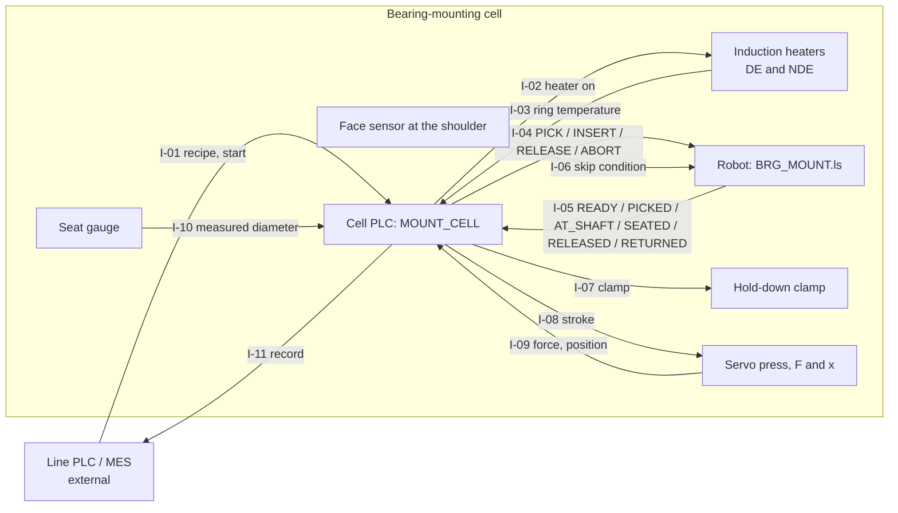
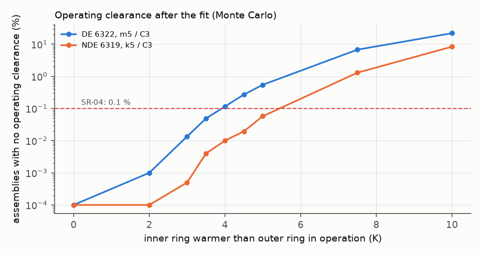
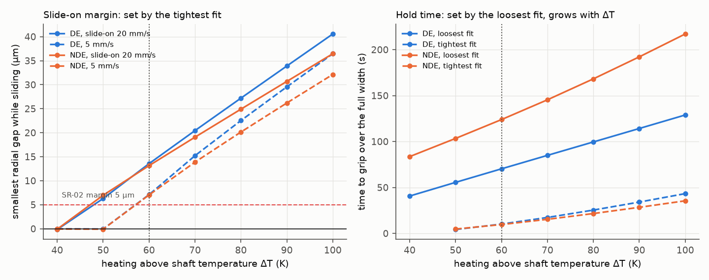
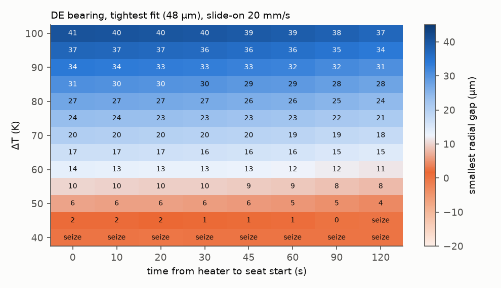
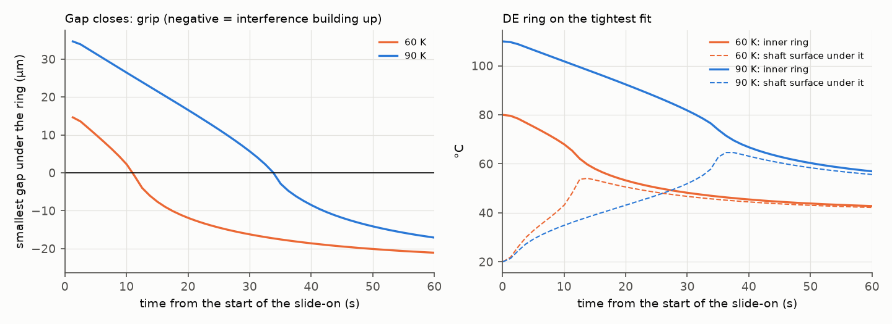
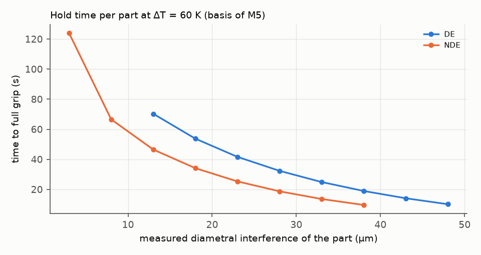
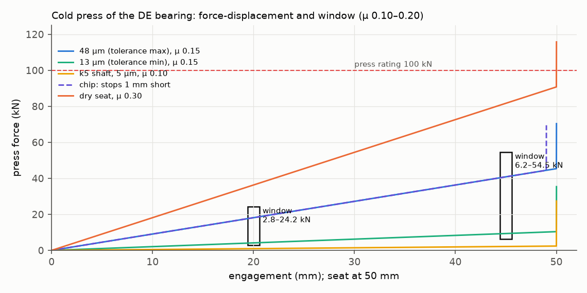
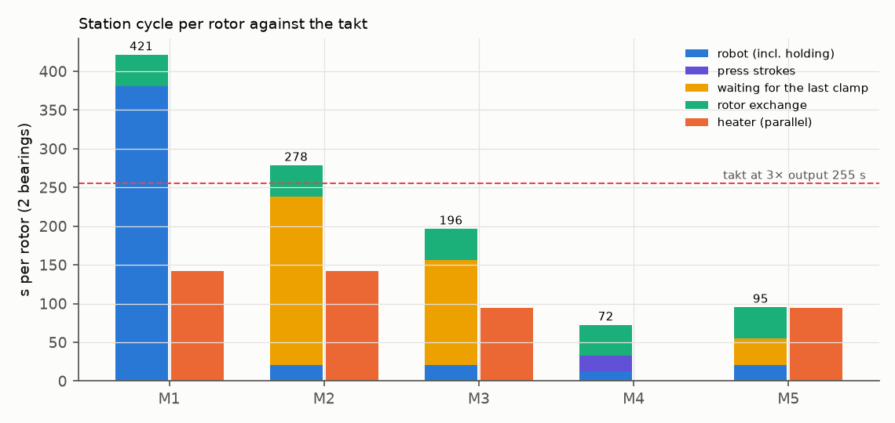

# Robot cell for mounting the bearings of an LV-alternator rotor: fit physics, process window and takt

**Systems-engineering dossier, revision 1.0 (10 Nov 2026).** Tables marked "generated" are written from
`results/studies.json` by `scripts/make_tables.py`; no result number is typed by hand. Every mounting cycle in this
study is run by the compiled IEC 61131-3 controller (`plc/st/mount_cell.st`, matiec) against models of the heater,
the robot, the hot slide-on and the press. The robot side is a FANUC TP program (`robot/BRG_MOUNT.ls`).

**Central question.** A robotised rotor line must mount the drive-end bearing (6322 C3 on a 110 mm m5 seat) and the
non-drive-end bearing (6319 C3 on a 95 mm k5 seat) of a 4-pole LV alternator at the takt of a tripled output
(255 s per rotor). Should the cell heat the bearings and slide them on, or press them on cold? For hot mounting, what
heating, transfer, slide-on and hold times does the physics allow, and what decides the cycle?

**Short answer.** The cell meets the takt by heating the bearing *less*, not more, and by holding it with a clamp
instead of the robot. Two different fits decide two different limits:
- the **tightest** fit (48 µm on the DE seat) sets the slide-on margin. The smallest heating that keeps a 5 µm gap
  even at a slow 5 mm/s slide-on is ΔT = 60 K;
- the **loosest** fit (13 µm DE, 3 µm NDE) sets the hold time: the ring has to cool back almost to the shaft
  temperature before it grips. At 90 K that takes 114 s (DE) and 192 s (NDE); at 60 K, 70 s and 124 s.

The usual practice of heating to about 110 °C (90 K) and holding with the robot gives 421 s per rotor, 1.65× the takt.
A clamp at 90 K gives 278 s. The window minimum (60 K) with a clamp and the NDE bearing mounted first gives 196 s. If
the seat diameter is gauged before mounting and the hold time is set per part from its measured interference, the
cycle falls to 95 s, and it is then set by the heater. A cold servo press is faster still (72 s), but it pushes up to
64 kN through the seat, and its force window cannot tell a wrong tolerance class from friction scatter: it rejects
0.9 % of k5 shafts on the m5 seat. The DE fit itself (m5 with C3 clearance) is safe only while the inner ring runs
less than about 4 K warmer than the outer ring.

**How to read the evidence.** Every value carries a tag: **[S]** sourced (§13), **[D]** derived here (model and
file named), **[A]** assumed. The method follows Wasson, *System Engineering Analysis, Design, and Development*,
2nd ed., Wiley 2016 [W]; page numbers are the printed ones.

---

## 0. Findings

1. **The process window has two edges from two different fits** (§6.3). The slide-on gap closes first where the
   interference is largest; the grip comes last where it is smallest. Raising ΔT widens the first edge and lengthens
   the second: from 60 to 90 K the DE slide-on margin grows from 13.6 to 33.9 µm and the loosest-fit hold from 70 to
   114 s.
2. **The window minimum is 60 K** (§6.3). At 50 K the tightest DE fit still slides at 20 mm/s (6.3 µm) but seizes at
   5 mm/s, and a protective stop half way through the slide-on seizes it after 3.5 s. At 60 K the margins are
   13.6 / 7.1 µm (20 / 5 mm/s), and a stop may last 10.1 s. Below 50 K the DE ring seizes on the tightest fit.
3. **Transfer time is not the risk, a stop on the seat is** (§6.3). In air the 9.65 kg bearing cools slowly: at 60 K
   any heater-to-seat time up to 300 s keeps the margin. Once part of the ring is on the shaft, the 15–35 µm air gap
   conducts like a 760–1600 W/m²K contact and the ring cools in tens of seconds. The safety concept must not stop the robot
   in the middle of a slide-on for longer than 10 s (60 K) or 44 s (90 K).
4. **Released at its first grip, the ring opens a face gap of up to 15 µm** (§6.3; SR-01: 10 µm). The first grip is
   not at the face: on the tightest fit it starts 12–22 mm from the face. The ring must be held until it
   grips over its full width. A hold timer that is too short passes the PLC unnoticed (§9, scenario "hold 5 s").
5. **Takt at 3× output: only the clamp-held alternatives at 60 K and the press meet it** (§8): M1 421 s, M2 278 s,
   M3 196 s, M4 72 s, M5 95 s against 255 s. Mounting the NDE bearing first hides the longer NDE hold behind the DE
   mount (M2: 289 → 278 s; M3: 207 → 196 s).
6. **A per-part hold halves the hot cycle** (§8). The full-grip time falls from 70 s at 13 µm to 10 s at 48 µm (DE).
   Gauging the seat and setting the hold per part (M5) cuts the mean clamp wait from 135 to 34 s, and it records the
   one number that proves the fit: the measured interference.
7. **The press window proves the seat, not the fit** (§7). With µ = 0.10–0.20 the window at 0.9·B spans 6.2–54.5 kN;
   it rejects only interferences below 7.8 µm, 0.9 % of k5 shafts and 0.01 % of 5 µm undersize grinds. A specified
   paste (µ 0.12–0.15) narrows it to 7.5–40.9 kN and still rejects only 1.9 % of k5 shafts. It does catch the gross
   faults: a missing fit, a dry seat (over-force) and an obstacle (no seat).
8. **The DE fit is limited by the operating clearance** (§6.2). m5 + C3 leaves 0.546 % of DE bearings without
   operating clearance at a 5 K inner/outer temperature difference; SR-04 (0.1 %) holds only up to about 3.5–4 K.
   CN clearance with m5 fails badly (66 % at 5 K). The NDE k5 + C3 holds to 5 K (0.057 %).

---

## 1. Need, problem space and stakeholders ([W] ch. 4–5)

**System of interest (SOI).** The bearing-mounting cell of a rotor line: one 6-axis robot (25 kg class), one
induction heater per bearing size, a hold-down clamp or a servo press, a seat-face sensor, and the cell PLC.

**Higher-order system.** The robotised rotor assembly line: shaft and rotor core → exciter armature and rotating
rectifier → fan → **bearings** → balancing → rotor into the stator.

| Role | Who | What they need from the SOI |
|---|---|---|
| Production | Rotor line | A cycle inside the takt at 3× output, with one robot |
| Technologist | Owner of the mounting process | A process window derived from the fit, with limits the PLC can enforce |
| Quality | Final test, field returns | Bearings seated against the shoulder, with operating clearance, and a record per rotor |
| Maintenance / safety | Cell | A cell that tolerates protective stops without scrapping rotors |
| End user | Generating-set operator | No bearing preload or creep: the drive-end bearing carries the rotor and the coupling |

**Problem statement** ([W] Principle 4.15, p. 91). Manual bearing mounting heats "to about 110 °C" and pushes the
bearing on by hand. A robot repeats whatever recipe it is given. The recipe parameters (heating, transfer, slide-on
speed, hold time, press force window) come from the fit tolerances, the bearing's internal clearance, heat transfer
and friction, and they interact.

**Measures** ([W] Principles 5.10–5.11, p. 115): MOE-1 cycle per rotor against the takt; MOE-2 slide-on margin (µm);
MOE-3 seat (face gap after cooling); MOS-1 evidence of the fit per part; MOS-2 force through the seat; MOS-3 robustness
to a protective stop.

## 2. Concept of operations ([W] ch. 5–6)

| Phase | What happens | What the physics asks |
|---|---|---|
| Recipe release | Per rotor type: bearing, fit, ΔT, limits | Process window (§6.3), press window (§7) |
| Heat | Induction heater to shaft temperature + ΔT (never above 120 °C) | Heating time ∝ ΔT |
| Pick and transfer | Robot lifts the bearing and moves it to the seat start | Air cooling, slow (§6.3) |
| Slide-on | Robot moves the ring to the shoulder, stops on the face sensor (skip) | Gap > 5 µm everywhere until the face is at the shoulder |
| Hold | Robot or clamp holds the ring against the shoulder | Until full grip (§6.3) |
| Press (M4) | Robot leaves the ring on the lead-in; servo press strokes to the shoulder | Force window, over-force, seat rise (§7) |
| Record | Verdict, ΔT, transfer and hold times or the F-x points, per rotor | Traceability |

**UC-1 "mount a bearing"**: preconditions — rotor clamped, seat cleaned and gauged (M5), robot ready; trigger — the
line PLC starts the cell; main scenario as above; extensions — slow transfer → back to the heater (re-heat, at most
once); not seated in time → NOK; protective stop → fault; over-temperature → fault.

## 3. Modes and states ([W] ch. 7)

States of `MOUNT_CELL` (`plc/st/mount_cell.st`):

| State | Entry | Allowed | Prohibited (Principle 7.10, p. 169) |
|---|---|---|---|
| S0 Idle | Reset | Recipe download | Heating, robot commands |
| S1 Heat | Start, safety OK, robot ready | Heater on | Bearing above 120 °C |
| S2 Pick | Bearing at shaft + ΔT | Robot picks | — |
| S3 Transfer | Robot reports "picked" | Robot moves | Transfer longer than the recipe limit (→ S6) |
| S4 Insert | Robot at the seat start | Slide-on | Insert time over the limit (→ NOK, seized) |
| S5 Hold | Face sensor at the shoulder | Robot or clamp holds | Release before the hold time |
| S6 Return | Transfer too slow | Robot returns the bearing to the heater | More re-heats than allowed |
| S7 Press | Robot at the seat start (press methods) | Press stroke, window evaluation | Force over the press limit |
| S8 Done / S9 Fault | Verdict / safety, over-temperature | Reset | Any motion command |

## 4. Requirements ([W] ch. 19–22)

| ID | Requirement | Source | Verification |
|---|---|---|---|
| SR-01 | The ring face shall be within 10 µm of the shaft shoulder after cooling. | [A] (a seat check after cooling) | Analysis (held until full grip); Test (feeler / dial at the face) |
| SR-02 | While the ring slides on, the radial gap shall stay at least 5 µm everywhere, for the whole fit tolerance, at 20 mm/s and at 5 mm/s. | [A] margin for out-of-roundness and cocking | Analysis (§6.3) |
| SR-03 | No bearing shall be heated above 120 °C. | Open bearings must not be heated above 120 °C [B1] p. 203 [S] | Analysis; PLC limit |
| SR-04 | Fewer than 0.1 % of mounted bearings shall run without radial clearance in operation. | [A]; fit and clearance data [B1] [S] | Analysis (§6.2); type test (ring temperatures) |
| SR-05 | The cell shall mount both bearings of a rotor within the takt of 3× today's output (255 s). | Line plan [A]: 60 → 180 rotors/day, 2 shifts of 7.5 h, OEE 0.85 | Analysis (§8) |
| SR-06 | Each mount shall leave a record that shows the seat and the fit. | Traceability [A] | Inspection |
| SR-07 | Bearing and gripper shall be within the robot payload (25 kg). | Robot data [B5] [S] | Analysis (test) |

**Derived requirements** ([W] Principle 21.2, p. 437):

| ID | Derived requirement | From |
|---|---|---|
| DR-01 | Heat to shaft temperature + 60 K (window minimum), not to a fixed 110 °C. | SR-02, SR-05, §6.3 |
| DR-02 | Hold the ring against the shoulder until it grips over its full width: 1.2 × the full-grip time of the loosest fit (85 s DE, 149 s NDE at 60 K), or per part from the gauged interference (M5). | SR-01, §6.3 |
| DR-03 | A protective stop during the slide-on shall not last longer than 10 s at 60 K; the cell shall then pull the ring off and re-heat it. | SR-02, §6.3 |
| DR-04 | Hold with a clamp, not with the robot; mount the NDE bearing first. | SR-05, §8 |
| DR-05 | On the DE bearing, measure the inner/outer ring temperature difference in the type test; above 3.5 K use a larger clearance group than C3. | SR-04, §6.2 |
| DR-06 | If a press is used, specify the mounting paste (µ range) and do not use the force window as evidence of the fit class. | SR-06, §7 |

## 5. Architecture and interfaces ([W] ch. 26–27)

| ID | Interface | Definition |
|---|---|---|
| I-01 | Recipe | method, ΔT, 120 °C limit, transfer limit, insert limit, hold time, press window (x1, x2, force bands), seat position |
| I-04/05 | Robot handshake | `robot/io_map.yaml`: DI 101–104 from the PLC, DO 101–106 to the PLC; checked against the TP program and the ST variables by `tests/test_interfaces_and_plc.py` |
| I-06 | Face sensor | Robot DI 110, SKIP CONDITION on the slide-on move (`L PR[5] R[10]mm/sec FINE Skip,LBL[80]`) |
| I-10 | Seat gauge (M5) | Seat diameter → interference with the bearing bore class → hold time from §6.3 |

## 6. Design, budgets and margins ([W] ch. 31)

### 6.1 Fit physics (`mount/fits.py`)

Equal materials, solid shaft, Lamé thick-cylinder theory:

    δ = d·p/E · [ (b² + a²)/(b² − a²) + ν ] + d·p/E · (1 − ν)  =  d·p/E · 2b²/(b² − a²)      a = d/2, b = d1/2
    raceway growth Δd1 = 2·u(b) = 4·p·a²·b / (E·(b² − a²))   →   Δd1/δ = a/b = d/d1          [D]
    press force F(x) = µ·p·π·d·x

For the 6322 the raceway grows by f1 = 0.772 of the interference, for the 6319 by 0.784 [D] (the ratio a catalogue
reads from a diagram [B1] p. 184). Inner-ring outer diameter d1 = d + 0.25(D − d) [A]. Interference lost to surface
smoothing 0.4·(Rz_shaft + Rz_bore) = 2.6 µm [A]. Steel data [B2] [S].

### 6.2 Fit selection and operating clearance (generated)

Operating clearance = catalogue clearance (uniform in its group [B1]) − f1 × effective interference − 0.012·ΔT·dm
(inner/outer temperature difference, [B1] p. 184) [S formula]. Shaft and bore normally distributed in their fields
(6σ = field) [A]; 200 000 draws.

<!-- TABLE:fits -->
| Bearing | Shaft | Clearance | Interference (µm) | Max pressure (MPa) | Max hoop stress (MPa) | Cold press force, µ 0.20 (kN) | Operating clearance mean / worst case (µm) | No clearance in operation |
|---|---|---|---|---|---|---|---|---|
| DE | k5 | C3 | 3–38 | 14.7 | 58 | 51 | 26.7 / -1.8 | 0.000 % |
| DE | m5 | C3 | 13–48 | 18.5 | 73 | 64 | 19.0 / -9.5 | 0.546 % |
| DE | m6 | C3 | 13–55 | 21.2 | 84 | 73 | 16.3 / -14.9 | 3.243 % |
| DE | n6 | C3 | 23–65 | 25.1 | 99 | 87 | 8.5 / -22.7 | 21.865 % |
| DE | m5 | CN | 13–48 | 18.5 | 73 | 64 | -4.0 / -30.5 | 65.528 % |
| DE | m6 | CN | 13–55 | 21.2 | 84 | 73 | -6.7 / -35.9 | 75.606 % |
| NDE | k5 | C3 | 3–38 | 16.2 | 68 | 44 | 21.1 / -6.6 | 0.057 % |
| NDE | m5 | C3 | 13–48 | 20.5 | 86 | 55 | 13.3 / -14.4 | 6.035 % |
| NDE | k5 | CN | 3–38 | 16.2 | 68 | 44 | 1.1 / -24.6 | 45.234 % |
| NDE | m5 | CN | 13–48 | 20.5 | 86 | 55 | -6.7 / -32.4 | 77.708 % |
<!-- /TABLE -->

The catalogue's choices (m5 on the 110 mm DE seat, k5 on the 95 mm NDE seat [B1] p. 148) are right, but the DE
bearing is close to the edge. The operating temperature difference is the deciding assumption:

<!-- TABLE:dt -->
| Inner ring warmer than outer (K) | 0 | 2 | 3 | 3.5 | 4 | 4.5 | 5 | 7.5 | 10 |
|---|---|---|---|---|---|---|---|---|---|
| DE m5 / C3: no clearance | 0.000 % | 0.001 % | 0.013 % | 0.049 % | 0.116 % | 0.271 % | 0.546 % | 6.745 % | 21.936 % |
| NDE k5 / C3: no clearance | 0.000 % | 0.000 % | 0.001 % | 0.004 % | 0.010 % | 0.019 % | 0.057 % | 1.298 % | 8.343 % |
<!-- /TABLE -->

### 6.3 Hot mounting: the transient model and the process window (`mount/thermal.py`)

The inner ring is 20 axial nodes (radially lumped; Bi < 0.02), coupled through the balls (3 W/K [A]) to the rest of
the bearing. The shaft is a 22 × 33 (r, z) finite-volume grid under and around the seat. While a ring node is over
the seat it exchanges heat with the shaft surface through the radial gap:

    h = k_air / (g + g_jump) + h_rad,     g = [d − δ + α·d·(T_ring − T0) − (d + α·d·(T̄_shaft − T0))] / 2

with k_air = 0.0288 W/mK at 60 °C [B3], g_jump = 3 µm [A], and 20 kW/m²K once the gap has closed [A]. T̄_shaft is
the slice-wise area-mean shaft temperature: the surface displacement of a long solid cylinder with a radial profile
T(r) is α·R·T̄ [D]. The leading face slides from the lead-in to the shoulder at the slide-on speed; a node whose gap
closes before the face reaches the shoulder seizes the ring.

**Why the gap matters more than the transfer.** In air (h = 15 W/m²K [A]) the inner ring loses less than 0.1 K in the
1.9 s nominal transfer (time constant about 35 min). On the shaft, a 15–35 µm gap gives k/(g + g_jump) ≈
760–1600 W/m²K: the ring's time constant drops from tens of minutes to tens of seconds.

<!-- TABLE:window -->
| Bearing | ΔT (K) | Heating (s) | Smallest gap 20 / 5 mm/s (µm) | Longest heater-to-seat time (s) | Longest stop half way (s) | Full grip, tightest / loosest fit (s) | Face gap if released at first grip, tightest / loosest (µm) |
|---|---|---|---|---|---|---|---|
| DE | 40 | 63 | -0.2 / -0.0 | 0 | 0.0 | — / 40.6 | — / 4.6 |
| DE | 50 | 79 | 6.3 / -0.1 | 76 | 3.5 | 4.2 / 55.5 | 3.0 / 4.6 |
| DE | 60 | 94 | 13.6 / 7.1 | ≥ 300 | 10.1 | 10.2 / 70.3 | 7.3 / 4.5 |
| DE | 70 | 110 | 20.4 / 15.2 | ≥ 300 | 19.0 | 17.4 / 84.9 | 11.0 / 5.0 |
| DE | 80 | 126 | 27.2 / 22.5 | ≥ 300 | 30.2 | 25.4 / 99.5 | 11.8 / 5.6 |
| DE | 90 | 142 | 33.9 / 29.6 | ≥ 300 | 43.6 | 34.1 / 114.2 | 14.3 / 5.0 |
| DE | 100 | 157 | 40.6 / 36.4 | ≥ 300 | 59.1 | 43.3 / 128.9 | 15.2 / 4.3 |
| NDE | 40 | 38 | -0.1 / -0.1 | 0 | 0.0 | — / 83.6 | — / 1.8 |
| NDE | 50 | 47 | 7.0 / -0.1 | 117 | 4.2 | 4.7 / 103.4 | 4.7 / 1.7 |
| NDE | 60 | 56 | 13.1 / 7.0 | ≥ 300 | 9.8 | 9.6 / 123.9 | 5.1 / 1.5 |
| NDE | 70 | 66 | 19.1 / 13.9 | ≥ 300 | 17.1 | 15.3 / 145.4 | 9.3 / 1.7 |
| NDE | 80 | 75 | 24.9 / 20.1 | ≥ 300 | 26.0 | 21.6 / 168.2 | 11.4 / 2.0 |
| NDE | 90 | 84 | 30.7 / 26.2 | ≥ 300 | 36.8 | 28.4 / 192.2 | 12.2 / 2.2 |
| NDE | 100 | 94 | 36.4 / 32.1 | ≥ 300 | 48.8 | 35.5 / 217.1 | 11.4 / 2.5 |
<!-- /TABLE -->

**Reading the window.**
- The slide-on margin grows by about 0.7 µm per K: the free expansion α·d/2 is 0.66 µm/K for the DE ring [D].
- The hold time grows with ΔT too, and it is set by the loosest fit. A ring with 13 µm of interference must cool
  until α·d·(T_ring − T̄_shaft) < 13 µm, about 10 K above the shaft; from 90 K that takes 114 s.
- The window minimum is the smallest ΔT whose margin holds at 5 mm/s and that tolerates a 15 s pause in transfer
  [A]: **60 K** for both bearings (`dT_window_min`).
- The full-grip time against the actual interference (60 K) is the basis of the per-part hold of M5:

<!-- TABLE:hold -->
| Interference (µm) | 13 | 18 | 23 | 28 | 33 | 38 | 43 | 48 |
|---|---|---|---|---|---|---|---|---|
| DE full grip (s) | 70.3 | 53.7 | 41.6 | 32.4 | 24.9 | 19.0 | 14.1 | 10.2 |
| NDE interference (µm) | 3 | 8 | 13 | 18 | 23 | 28 | 33 | 38 |
| NDE full grip (s) | 123.9 | 66.6 | 46.5 | 34.1 | 25.3 | 18.7 | 13.6 | 9.6 |
<!-- /TABLE -->

### 6.4 Payload and heater budget

Bearing 9.65 kg (6322) + gripper 8 kg [A] = 17.65 kg against 25 kg [B5]. Heating by 60 K: 94 s (DE) and 56 s (NDE) at
3.6 kW and 80 % [A]; by 90 K: 142 s and 84 s.

## 7. Cold press: the force window and what it can prove

F(x) = µ·p(δ)·π·d·x rises linearly with the engagement; at the shoulder the stroke stops and the force rises steeply
(50 kN/mm [A]). The window at x1 = 0.4·B and x2 = 0.9·B is the band from (smallest effective interference, lowest
µ) to (largest interference, highest µ). Because F ∝ µ·δ, the window cannot separate a low interference with high
friction from a high interference with low friction. The rejected share of wrong parts is a Monte Carlo over shaft,
bore and µ (20 000 draws):

<!-- TABLE:press -->
| Bearing | Friction range | Window at x1 (kN) | Window at x2 (kN) | Interference surely rejected below (µm) | k5 shafts rejected | 5 µm undersize grind rejected | Friction work at max fit (J) |
|---|---|---|---|---|---|---|---|
| DE | µ 0.10–0.20 | 2.8–24.2 | 6.2–54.5 | 7.8 | 0.9 % | 0.01 % | 1600 |
| DE | µ 0.12–0.15 (paste) | 3.3–18.2 | 7.5–40.9 | 10.9 | 1.9 % | 0.05 % | 1600 |
| NDE | µ 0.10–0.20 | 0.1–16.2 | 0.2–36.5 | 2.8 | 0.0 % | 0.11 % | 980 |
| NDE | µ 0.12–0.15 (paste) | 0.1–12.2 | 0.2–27.4 | 2.9 | 0.0 % | 0.08 % | 980 |
<!-- /TABLE -->

What the window does catch is the gross fault: a fit far below tolerance (k5 at 5 µm: NOK at x1), a dry seat
(µ 0.30: over-force before the shoulder), and an obstacle (stroke 1 mm short: no seat rise at the seat position)
(§9). The friction work dissipated at the seat is 1.6 kJ (DE) at the largest fit and µ 0.20 [D], the reason hot
mounting is preferred for large bearings when the seat surface matters.

## 8. Trade study: analysis of alternatives ([W] ch. 32)

| | Method | Heating | Hold | Fit evidence |
|---|---|---|---|---|
| M1 | Hot mount | 90 K | Robot holds | ΔT and times only |
| M2 | Hot mount | 90 K | Clamp; robot released | ΔT and times only |
| M3 | Hot mount | Window minimum (60 K) | Clamp | ΔT and times only |
| M4 | Cold servo press | — | — | F-x window (seat, gross faults) |
| M5 | Hot mount, per-part hold | 60 K | Clamp, hold from gauged interference | Measured interference per part |

Each alternative was run in the closed loop for both bearings at both tolerance ends:

<!-- TABLE:takt -->
| | Alternative | ΔT (K) | Robot (s) | Press (s) | Wait for clamp (s) | Heater (s) | Best order | Cycle per rotor (s) | Takt 255 s |
|---|---|---|---|---|---|---|---|---|---|
| M1 | Hot mount 90 K, robot holds until locked | 90 | 381 | 0 | 0 | 142 | DE-NDE | 421 | **misses** |
| M2 | Hot mount 90 K, hold-down clamp, robot released | 90 | 21 | 0 | 217 | 142 | NDE-DE | 278 | **misses** |
| M3 | Hot mount at the window minimum, hold-down clamp | 60 | 21 | 0 | 135 | 94 | NDE-DE | 196 | meets |
| M4 | Cold servo press with force-displacement window | 0 | 13 | 20 | 0 | 0 | DE-NDE | 72 | meets |
| M5 | As M3, hold time per part from the gauged seat interference | 60 | 21 | 0 | 34 | 94 | NDE-DE | 95 | meets |
<!-- /TABLE -->

<!-- TABLE:gates -->
| Requirement | M1 | M2 | M3 | M4 | M5 |
|---|---|---|---|---|---|
| SR-01 seat | pass | pass | pass | pass | pass |
| SR-02 no seizure | pass | pass | pass | pass | pass |
| SR-03 120 °C | pass | pass | pass | pass | pass |
| SR-05 takt | **fail** | **fail** | pass | pass | pass |
<!-- /TABLE -->

SR-04 (clearance) is a fit choice, the same for every method (§6.2); SR-06 (record) is met by all, with the
different evidence listed above; SR-07 is met (§6.4).

**Trade study report (Principle 32.9, p. 698): recommendation.**
1. **M5**: hot mounting at the window minimum (60 K), clamp hold, NDE first, hold time per part from a gauged seat
   diameter. 95 s per rotor (heater-bound), no press force through the seat, and the only alternative that records the
   actual interference of every bearing. It needs a seat gauge and a recipe calculation in the PLC (DR-02).
2. **M3** if no gauge is fitted: 196 s, inside the takt with 59 s to spare.
3. **M4** only if the seat surface and up to 64 kN at the shoulder are acceptable; specify the paste (DR-06) and do not read its window
   as fit evidence.
4. **Not M1**: the robot-held hot mount at 90 K is the manual practice automated, and it needs 421 s.

## 9. Reliability: FMEA ([W] ch. 34)

S, O, D rated 1–10 [A]; RPN = S·O·D. Items marked ▲ are quantified in the closed loop.

| ID | Failure mode | Effect | Detection | S | O | D | RPN | Mitigation |
|---|---|---|---|---|---|---|---|---|
| FM-01 ▲ | Protective stop half way through the slide-on | Ring grips part-way: seized, rotor to rework | Insert time-out (NOK "not seated") | 8 | 3 | 2 | 48 | DR-03: stop ≤ 10 s at 60 K, else pull off and re-heat; mute non-safety stops during the 2.6 s slide-on |
| FM-02 ▲ | Robot slow or paused in transfer | Ring cooler at the seat | Transfer timer | 5 | 3 | 2 | 30 | Return to the heater (re-heat once) |
| FM-03 ▲ | Hold timer shorter than the full grip | Face gap up to 15 µm after cooling | **None in the PLC** | 7 | 2 | 9 | 126 | DR-02 hold from the model; face-gap check after cooling on a sample basis |
| FM-04 ▲ | Shaft from the wrong tolerance class (press) | Wrong clearance / creep | F-x window catches only gross cases | 7 | 2 | 8 | 112 | Seat gauge (M5) |
| FM-05 ▲ | Dry seat (press) | Over-force, seat scoring | Over-force | 6 | 3 | 2 | 36 | Paste dosing check |
| FM-06 ▲ | Chip or cocked ring (press) | Ring not at the shoulder | No seat rise | 8 | 3 | 2 | 48 | Seat cleaning, NOK |
| FM-07 | Heater temperature probe drifts high | Bearing above 120 °C | Second probe / plausibility vs heating time | 7 | 2 | 5 | 70 | Heating-time plausibility (energy balance, §6.4) |
| FM-08 | Bearing heated without the shaft temperature known | ΔT wrong | Shaft probe missing | 5 | 3 | 3 | 45 | Shaft temperature is a recipe input |
| FM-09 | Inner/outer ring difference > 4 K in service | Bearing preloaded | Bearing temperature in the type test | 8 | 3 | 6 | 144 | DR-05 |

**Scenarios run in the closed loop** (generated, DE bearing):

<!-- TABLE:scen -->
| Scenario (DE bearing) | PLC verdict | Reason | Re-heats | Smallest gap (µm) | Held until full grip |
|---|---|---|---|---|---|
| Protective stop of 10 s half way, 90 K (M2) | OK | — | 0 | 25.8 | yes |
| Slide-on at 5 mm/s, window minimum (M3) | OK | — | 0 | 7.1 | yes |
| Protective stop of 10 s half way, window minimum (M3) | OK | — | 0 | 0.5 | yes |
| Robot paused 90 s in transfer, 50 K, transfer interlock on | OK | — | 1 | 6.3 | yes |
| Same, interlock off | OK | — | 0 | 4.7 | yes |
| Hold 5 s instead of the recipe, loosest fit (M2) | OK | — | 0 | 51.9 | **no** |
| Press: k5 shaft at 5 µm, µ 0.10 (M4) | NOK | force at x1 | 0 | — | — |
| Press: dry seat µ 0.30, 48 µm (M4) | NOK | over-force | 0 | — | — |
| Press: chip, stroke stops 1 mm short (M4) | NOK | no seat | 0 | — | — |
<!-- /TABLE -->

The "hold 5 s" row is the important one: the PLC sees a normal cycle, and only the model says the ring was released
100 s before it had gripped. That is why the hold time is a derived requirement (DR-02) and not a tuning value.

## 10. Verification and validation ([W] ch. 13, 28)

### 10.1 Verification matrix

| Req. | Method here | Evidence | In the plant |
|---|---|---|---|
| SR-01 | Analysis (closed loop, both tolerance ends) | §8, `seat_held_until_full_grip` | Face gap after cooling (feeler gauge), first 50 rotors |
| SR-02 | Analysis | §6.3 | Thermocouple on the inner ring; measured slide-on force on the robot (force sensor) |
| SR-03 | Analysis + PLC limit | §3, test | Heater log |
| SR-04 | Analysis (Monte Carlo) | §6.2 | Ring temperatures in the type test |
| SR-05 | Analysis | §8 | Cycle measurement after commissioning |
| SR-07 | Analysis | §6.4 | Robot load check (payload identification) |

### 10.2 Model verification (each against an independent result; `tests/`)

| Check | Independent reference | Result |
|---|---|---|
| Tolerance stack | Catalogue limits [B1] | 13–48 µm |
| Lamé pressure | General two-material press-fit formula | 1e-12 |
| Raceway growth f1 = a/b | Lamé displacement field of the ring alone | 1e-9 |
| Press force | Linear in engagement, zero without interference | exact |
| Clearance Monte Carlo | Worst-case formula with zero spread | 1e-6 |
| First gap on the seat | Free thermal expansion (α·d·ΔT − δ)/2 | within 0.3 µm |
| Transfer cooling | Newton cooling (balls and radiation off) | within 0.3 K |
| Hotter ring: more margin, later grip | Physics of §6.3 | pass |
| Too cold ring seizes | Physics of §6.3 | pass |
| Heater energy balance | m·c·ΔT | exact |
| Robot move time | Trapezoidal / triangular profile | exact |
| Robot program ↔ I/O map ↔ ST variables | Static check | pass |
| Compiled ST: hold time, re-heat, seizure, press window, safety stop, over-temperature | Specified behaviour (§3) | pass |

### 10.3 Validation

On a real cell: one instrumented DE inner ring (two thermocouples) and a dial at the face, mounted at 60 K on a shaft
gauged at both ends of the tolerance; the measured grip time (the ring can no longer be turned by hand on the gripper)
against §6.3, and the face gap after cooling against SR-01.

## 11. Assumed versus sourced, and limits

**Sourced [S]:** bearing dimensions, masses, ratings [B1]; shaft tolerance classes and limit deviations, bore
tolerance, internal clearance groups, the clearance-loss formula, the 120 °C limit [B1]; steel properties [B2];
air conductivity [B3]; greased steel friction [B4]; robot payload, reach and repeatability [B5].

**Assumed [A], and where it matters:**
- **Inner/outer ring temperature difference (5 K).** Decides SR-04 for the DE bearing (§6.2).
- **Gap jump distance, contact conductance, ball conductance.** They set the grip times; the ranking of the
  alternatives depends on the hold being long compared with the robot work, which holds for any value that keeps the
  grip above 10 s.
- **µ range of the press.** Sets the width of the window (§7).
- **Smoothing 0.4·(Rz1 + Rz2).** Shifts every effective interference by 2.6 µm.
- **Layout, speeds, demand.** Set the takt and the robot time.

**Limits:** axisymmetric, no cocking of the ring; the shaft surface displacement uses the slice mean temperature
(no axial coupling of the displacement); the outer ring and balls are one node; friction during the hot slide-on is
not modelled (the gap is open until it closes).

## 12. Decision log

| # | Decision | Alternatives | Rationale |
|---|---|---|---|
| D1 | Transient (ring nodes + shaft FV) model of the slide-on | Static "ΔT gives clearance" check | The static check says 40 K is enough for the DE fit (52.8 µm of expansion > 48 µm); the transient model shows it seizes, because the ring cools on the seat |
| D2 | Hold until full grip, not first grip | Release at first grip | First grip is 12–22 mm from the face; releasing then opens up to 15 µm (§6.3) |
| D3 | Window minimum includes a 5 mm/s slide-on | 20 mm/s only | Force-controlled approaches run slowly; 50 K passes at 20 mm/s and seizes at 5 mm/s |
| D4 | Warm-assisted press (40 K + press) dropped | Keep as M6 | The transient model shows the ring gripping part-way at 40 K, so the press would push against a ring whose interference grows during the stroke: neither a clean hot mount nor an interpretable F-x curve |
| D5 | Run the compiled ST controller in every cycle | Python re-implementation | One source of truth; the robot-PLC handshake is tested against the real variable names |
| D6 | Mount NDE first | DE first | Hides the longer NDE grip behind the DE mount (§8) |
| D7 | One heater per bearing size | One heater for both | Keeps heating off the critical path (95 s cycle is heater-bound even so) |

## 13. References

- **[W]** C. S. Wasson, *System Engineering Analysis, Design, and Development*, 2nd ed., Wiley, 2016.
- **[B1]** SKF, *Rolling bearings* catalogue (PDF): p. 38 Table 2 (bore tolerance, normal class), p. 148 Table 5 (shaft fits), pp. 160–162 Tables 14–15 (ISO 286 limit deviations), p. 184 (clearance reduction by fit and temperature), p. 203 (hot mounting, 120 °C), p. 252 Table 6 (radial internal clearance), pp. 290, 292 (6319, 6322). https://cdn.skfmediahub.skf.com/api/public/0901d196802809de/pdf_preview_medium/0901d196802809de_pdf_preview_medium.pdf
- **[B2]** 100Cr6 bearing steel data (density, E, ν, α, cp, k): https://steelnavigator.ovako.com/steel-grades/100cr6/
- **[B3]** Air thermal conductivity vs temperature: https://www.engineeringtoolbox.com/air-properties-viscosity-conductivity-heat-capacity-d_1509.html
- **[B4]** Friction coefficients (steel on steel, greased, static 0.16): https://www.engineeringtoolbox.com/friction-coefficients-d_778.html
- **[B5]** FANUC M-20iD/25 specifications (payload 25 kg, reach 1831 mm, repeatability ±0.02 mm): https://www.fanucamerica.com/products/robots/series/m-20/m-20id-25
- **[B6]** ANSI/EASA AR100-2025, Table 2-6: shaft fits for bearings no. 19 (k5) and no. 22 (m5), adapted from ABMA 7 (cross-check of [B1]).
