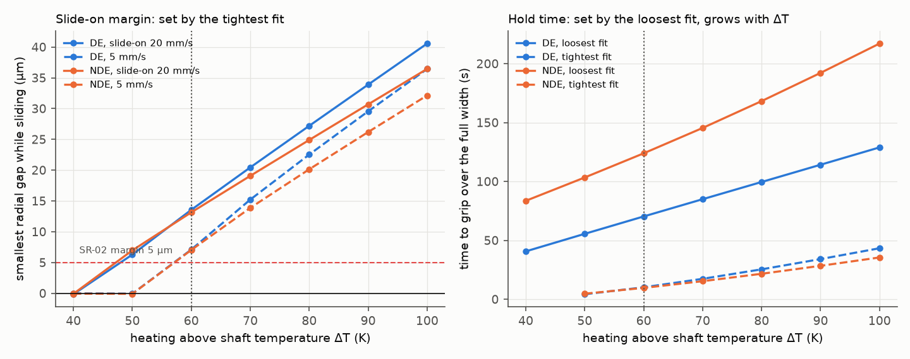
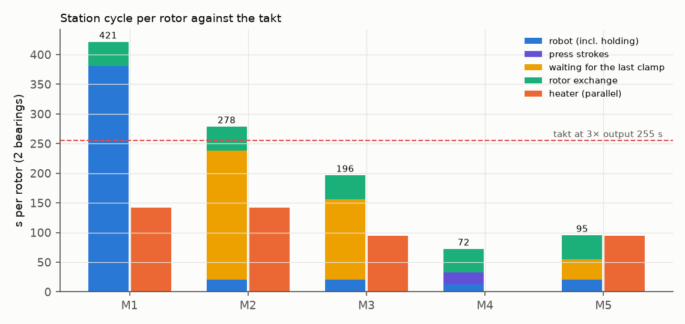
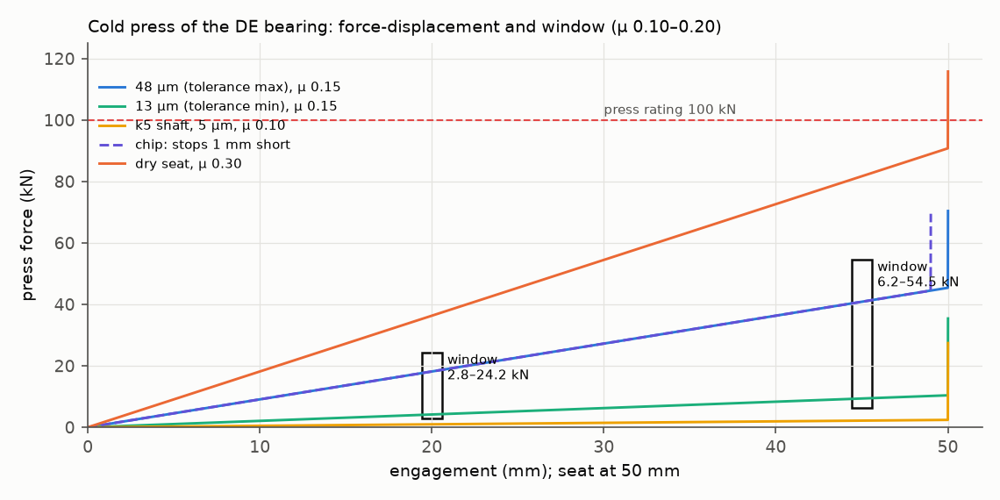

# Rotor bearing-mounting robot cell: fit physics, process window and takt

**Question.** A robotised rotor line for a 4-pole LV alternator must mount the drive-end bearing (6322 C3 on a 110 mm
m5 seat) and the non-drive-end bearing (6319 C3 on a 95 mm k5 seat) inside the takt of a tripled output (255 s per
rotor). Heat and slide on, or press on cold? For hot mounting, what heating, transfer, slide-on and hold times does
the physics allow, and what decides the cycle?

The study runs fit tolerances → Lamé interference physics → transient slide-on model → compiled PLC controller and
FANUC robot program in the loop → takt and trade study, on a systems-engineering spine (need, ConOps, modes,
requirements, architecture, budgets, analysis of alternatives, FMEA, V&V). Full report:
**[DOSSIER.md](DOSSIER.md)** ([PDF](DOSSIER.pdf)).

**Answer.** Heat less and hold with a clamp. Two fits set two edges of the window:
- the **tightest** fit sets the slide-on margin. 60 K above the shaft is the smallest heating that keeps a 5 µm gap
  even at a 5 mm/s slide-on. At 50 K a protective stop half way through the slide-on seizes the ring after 3.5 s;
- the **loosest** fit sets the hold time, because the ring must cool back almost to the shaft before it grips. At
  90 K that takes 114 s (DE) and 192 s (NDE); at 60 K, 70 s and 124 s.

The usual "heat to 110 °C, robot holds" recipe needs 421 s per rotor, against a takt of 255 s. A clamp at 60 K with
the NDE bearing mounted first needs 196 s. **Gauging the seat and setting the hold time per part from the measured
interference cuts it to 95 s**, and it records the one number that proves the fit. A cold servo press takes 72 s, but
it pushes up to 64 kN through the seat. Its force window proves the seat and catches gross faults, but it rejects
only 0.9 % of shafts from the wrong tolerance class (k5 instead of m5). The DE fit is safe only while the inner ring
runs less than about 4 K warmer than the outer ring: at 5 K, 0.55 % of bearings lose their operating clearance.



## What is in it

| Level | What | Where |
|---|---|---|
| Fit | ISO 286 / ISO 492 tolerance stack, Lamé pressure, raceway growth, press force, Monte Carlo of the operating clearance | `mount/fits.py` |
| Slide-on | Inner ring (axial nodes) + rest of the bearing + shaft (r, z) finite volumes; gap-dependent conductance; seizure, first and full grip, face gap; protective stop on the seat | `mount/thermal.py` |
| PLC | IEC 61131-3 ST function block `MOUNT_CELL`: heater, robot handshake, transfer interlock with re-heat, insert time-out, hold, clamp, press window, safety. Compiled with matiec and run in every simulated cycle; TIA Portal SCL export | `plc/st/mount_cell.st`, `plc/scl/MountCell.scl` |
| Robot | FANUC TP program with skip-condition slide-on and the handshake; I/O map checked against the ST variables | `robot/BRG_MOUNT.ls`, `robot/io_map.yaml` |
| Cell | Heater, trapezoidal robot moves, clamp, servo press with Lamé force; closed loop per bearing | `mount/plant.py` |
| Studies | Fit options, process window, press window, five alternatives, scenarios, takt | `scripts/run_studies.py` |
| Verification | Lamé against the general formula and the displacement field, free expansion, Newton cooling, energy balance, interface checks, controller behaviour | `tests/` |

## Results (generated from `results/studies.json`)

<!-- TABLE:takt -->
| | Alternative | ΔT (K) | Robot (s) | Press (s) | Wait for clamp (s) | Heater (s) | Best order | Cycle per rotor (s) | Takt 255 s |
|---|---|---|---|---|---|---|---|---|---|
| M1 | Hot mount 90 K, robot holds until locked | 90 | 381 | 0 | 0 | 142 | DE-NDE | 421 | **misses** |
| M2 | Hot mount 90 K, hold-down clamp, robot released | 90 | 21 | 0 | 217 | 142 | NDE-DE | 278 | **misses** |
| M3 | Hot mount at the window minimum, hold-down clamp | 60 | 21 | 0 | 135 | 94 | NDE-DE | 196 | meets |
| M4 | Cold servo press with force-displacement window | 0 | 13 | 20 | 0 | 0 | DE-NDE | 72 | meets |
| M5 | As M3, hold time per part from the gauged seat interference | 60 | 21 | 0 | 34 | 94 | NDE-DE | 95 | meets |
<!-- /TABLE -->





## Run it

```bash
pip install -r requirements.txt
bash scripts/build_plc.sh              # needs matiec (iec2c) and gcc: Linux or WSL
python -m pytest -q
python -m scripts.run_studies          # results/studies.json
python -m scripts.make_figures
python -m scripts.make_tables
python plc/st_to_scl.py plc/st/mount_cell.st plc/scl/MountCell.scl
```

CI builds matiec at a pinned commit, compiles the ST code, runs the tests and a quick study, and checks that the SCL
export matches the ST source.

## Assumptions and limits

The cell layout, speeds, demand and some heat-transfer values are assumptions; each is tagged in the dossier, and
the ones that can change a conclusion are discussed in §11. The bearing, tolerance and clearance data come from a
public bearing catalogue.

Sister projects: [alternator-transient-performance](https://github.com/chad416/alternator-transient-performance)
(the 800 kVA machine) and [stator-impregnation-cure](https://github.com/chad416/stator-impregnation-cure) (the stator
cure cycle).

MIT licence.
